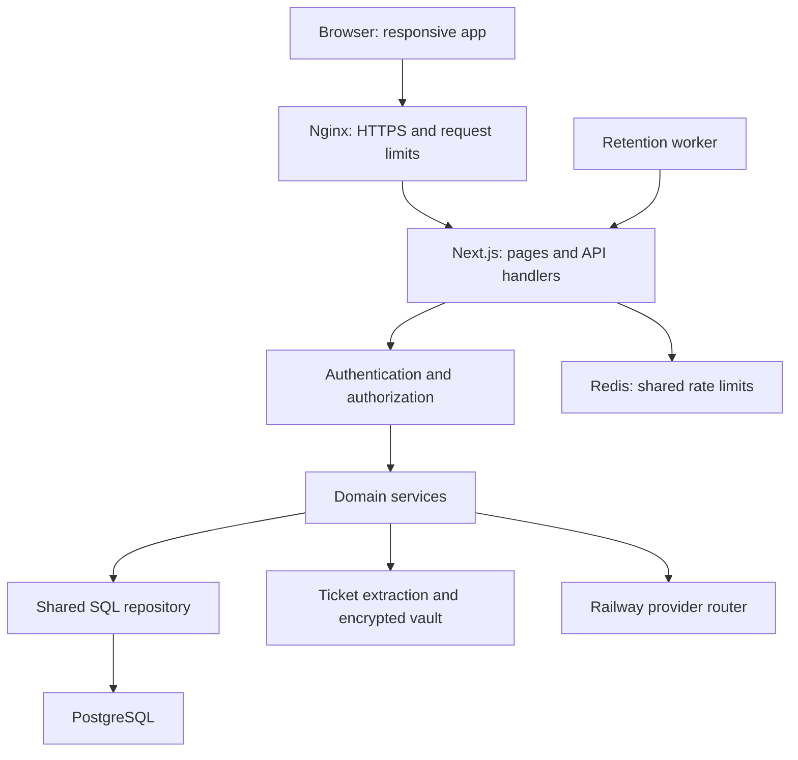

# Architecture review

Review date: 15 November 2026. Baseline commit: `5d72c4a7be63910cc5f9af5f2ad49e97c708ed13`.

## Result

RailBandhan remains a modular Next.js application. Rebuilding the existing domain modules preserves the working journeys, communication, games and moderation behavior while replacing the visual shell, fabricated product activity, fragile session model and misleading database fallback. A shared asynchronous SQL repository now serves SQLite and PostgreSQL. Production refuses memory storage and unsupported store names.

## Boundaries and implementation

| Area                | Current behavior                                                                                       | Important constraint                                                                                     |
| ------------------- | ------------------------------------------------------------------------------------------------------ | -------------------------------------------------------------------------------------------------------- |
| Rendering           | App Router, dynamic nonce-bearing HTML, server-rendered public pages and route chunks                  | Personalized documents must never be cached at an ingress/CDN                                            |
| Client state        | Local form state and cancellable `useApiResource`; shared API error and refresh handling               | No session tokens or private profile data in browser storage                                             |
| Motion              | IntersectionObserver and native transform/opacity animations; controllable film                        | Reduced motion, hidden tabs and data-saving preferences are respected                                    |
| Authentication      | Random 256-bit opaque access/refresh credentials, database hashes, rotation and family revocation      | Access lifetime 15 minutes; absolute refresh lifetime 7 days                                             |
| Authorization       | API-level session validation, journey membership, relationship/block checks, moderator/admin roles     | Middleware cookie presence is an early routing hint, never authorization                                 |
| Persistence         | `SqlStore` plus SQLite and `pg` connection adapters                                                    | PostgreSQL migrations must be applied before the server becomes ready                                    |
| Transactions        | AsyncLocalStorage-bound PostgreSQL clients; serialized SQLite transactions                             | Game moves, joins, votes, journey creation, ticket confirmation and deletion have transaction boundaries |
| Railway information | Provider routing, bounded JSON responses, coalescing, circuit breakers and labelled timetable fallback | Static route data is a limited catalog and needs operational maintenance                                 |
| Ticket processing   | MIME sniffing, bounded multipart body, bounded image decode, native local PDF/OCR tools                | OCR is not ticket authenticity verification or antivirus certification                                   |
| Background work     | Hourly authenticated retention worker with structured success/failure logs                             | There is no general durable job queue or guaranteed exactly-once scheduler                               |
| Communication       | API-backed chat, community posts, direct messages and polling                                          | There is no deployed WebSocket or Supabase Realtime transport                                            |
| Operations          | Readiness, authenticated Prometheus-format metrics, redacted logs, release image scan                  | Alert routing and dashboards must be provisioned separately                                              |

## Database

The system of record is PostgreSQL in production. The app has local authentication users, private and anonymous profiles, train/station catalog data, journeys and memberships, communities, posts/comments/reactions, chat, conversations/direct messages, ticket extractions, blocks/reports, notifications, games, polls, badges and session/consumed-refresh records.

Foreign keys enforce dependent cleanup. Session and refresh hashes are unique. Refresh rotation uses an atomic conditional update and a history table. A consumed refresh credential can revoke its session family. Partial unique indexes prevent duplicate train-wide communities and duplicate confirmed PNR hashes. Query indexes cover membership scope/expiry, chronological feeds, chat, notifications, extraction hashes, ticket retention and activity counters.

`CORE_SCHEMA` is the canonical schema. The migration runner uses a PostgreSQL advisory transaction lock, records a checksum in `app_migrations`, and refuses a changed already-applied migration. This is the first application migration because the former production PostgreSQL driver did not exist. Add numbered forward migrations for future releases; do not rewrite the applied initial migration. Existing Supabase-auth schemas require an explicit, separately tested data migration and are not interchangeable with this schema.

Local SQLite initialization is idempotent and enables foreign keys, WAL and a busy timeout. Its asynchronous wrapper serializes access across a transaction. PostgreSQL uses a bounded pool, connection/statement deadlines and certificate verification for remote hosts. Both drivers run the same repository behavior rather than maintaining duplicate SQL implementations.

## Security and privacy boundary

A traveller can join using manually entered details. The internal `verified` membership enum means the application admitted that membership. It does not establish physical presence, ownership of an authentic railway reservation or identity verification by Indian Railways. The rebuilt UI and help page state that limitation.

Discovery is off by default. Passenger listings exclude private profiles and emails, and hide blocked users. Public profile lookup requires a shared journey or ownership. Direct messages require a shared active membership and compatible messaging policies. Global moderator rights are checked on the server. No public endpoint assigns roles.

Ticket documents are encrypted with AES-256-GCM and private file permissions. The PNR is stored as a keyed hash, not plaintext. Original filenames are not used as storage paths or extraction evidence. Confirmation removes the document; retention removes abandoned documents. Account deletion revokes sessions and performs database cleanup transactionally, after password reauthentication.

## Deployment topology

The supplied Compose stack has one ingress, one app, PostgreSQL, Valkey and a retention worker. Only ports 80/443 are exposed. The database/cache network is internal. The web process is non-root, has a read-only root filesystem, dropped capabilities, process/memory/CPU limits and bounded temporary storage. Ticket files use a persistent private volume.

A single host is a starting topology, not high availability. The current ticket vault is local shared storage, so do not simply replicate the web service across hosts. Move extraction to isolated workers and the vault to encrypted private object storage before doing that. Store callbacks and domain logic can remain stable while the storage implementation changes.

## Capacity improvements in priority order

1. Before public account rollout, implement a verified email delivery, recovery and privileged-account MFA path or integrate a maintained identity provider. Current local passwords are hashed correctly, but recovery/verification are not implemented.
2. Before large communities, normalize poll ballots and game participants, introduce cursor pagination/history loading, and implement atomic reputation updates wherever a new write path is added. Current feed responses are bounded; the API does not yet expose older-page cursors.
3. Before multiple app hosts, isolate native OCR, add durable job/outbox processing and move ticket objects to a private shared vault. Keep deletion retries and audit events durable.
4. Before promising real-time presence, implement an authorized WebSocket/SSE transport with per-channel checks and measured fan-out limits. Current online state is unknown and is not fabricated.
5. Before a high-availability SLO, use managed PostgreSQL with point-in-time recovery, replicated cache, redundant ingress and tested restore/failover procedures.
6. Maintain the railway catalog against an authorized data source. Timetable interpolation is a model; it must never become an unlabeled claim of actual location, delay or platform.

These are explicit capacity and product gates, not claims that these systems have already been deployed.
